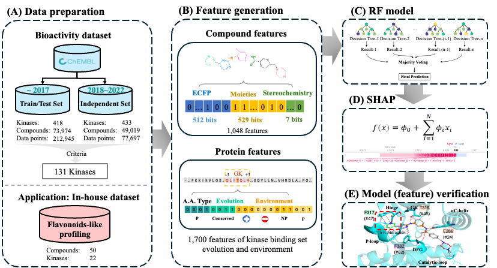

# Drug-Like Moieties and Binding-Site Evolution Enable Interpretable Kinase Inhibitor Prediction

This repository provides the datasets and source code associated with MoBEK, a kinase inhibitor prediction workflow that combines compound moiety descriptors with kinase binding-site evolution features.



**Overview of the MoBEK kinase inhibitor prediction framework.**

## Repository Structure

```text
.
├── environment.yml
├── overview.png
├── README.md
├── data
│   ├── independent.csv
│   ├── inhouse.csv
│   ├── test.csv
│   ├── train.csv
├── scripts
│   ├── ablation_study.py
│   ├── build_dataset_features.py
│   ├── evaluate_model.py
│   ├── interpret_model.py
│   └── train_model.py
└── src
    ├── ablation.py
    ├── interpret.py
    ├── metrics.py
    ├── model.py
    └── features
        ├── compound.py
        ├── Filter_BBA.csv
        ├── protein.py
        └── vendors
            ├── ac
            │   ├── Composition.cpp
            │   ├── Composition.h
            │   ├── Compound.h
            │   ├── Edge.h
            │   ├── Makefile
            │   └── String.h
            ├── bin
            │   ├── checkmol
            │   ├── matchmol
            │   └── mod_ac
            └── moieties
                ├── pubchem/
                └── rings_in_drugs/
```

## Requirements

- Python 3
- NumPy
- pandas
- scikit-learn
- RDKit
- Matplotlib
- SHAP

The bundled `checkmol`, `matchmol`, and `mod_ac` executables are Linux x86-64 binaries used by the compound-feature generator.

`checkmol` and `matchmol` can be downloaded from [link](https://homepage.univie.ac.at/norbert.haider/download/chemistry/checkmol/bin/?order=name&sort=desc) (version 0.5b N. Haider, University of Vienna, 2003–2018)  

`mod_ac` are inhouse tool to count amino acid composition, source code are provided in `src/features/vendors/ac/`. Using `g++` and `make` should compile it.

```bash
cd src/features/vendors/ac/
make
```

### Conda

To easier replicate the environment, `conda` could be used:

```bash
conda env create -f environment.yml -y
conda activate MoBEK
```

## Datasets

### Raw dataset

| File | Purpose | Records |
| --- | --- | ---: |
| `data/train.csv` | Model training set | 147,578 |
| `data/test.csv` | Held-out test set | 36,909 |
| `data/independent.csv` | Independent evaluation set | 57,244 |
| `data/inhouse.csv` | In-house evaluation set comprising 50 compounds across 22 kinases | 1,100 |

Each CSV contains 3 columns: `smiles`, `kinase`, `label`.

### Processed dataset

The above raw datasets are processed with `scripts/build_dataset_features.py` to generate the 1048 bits compound descriptors and 1700 bits kinase binding-site features.

The CSV files are stored in `full_features.tar.gz`, to get them:

```bash
cd data
tar zxvf full_features.tar.gz
```

## Source Code

### Feature

- `src/features/compound.py` generates Checkmol, PubChem, in-house moiety, Rings in Drugs, ECFP, MACCS, and atom-count descriptors from SMILES.
- `src/features/protein.py` generates kinase binding-site evolution features from `Filter_BBA.csv` using the KLIFS 85-position definitions.

### Model training, evaluation, and interpretation

- `src/model.py` Define a Random Forest classifier.
- `src/metrics.py` Define metrics and evaluates model on the held-out test and independent datasets.
- `src/interpret.py` contains the MoBEK feature-importance, and SHAP analysis workflow.

A pretrained model is not included. Each model script trains its own Random Forest classifier from `data/train_full_features.csv`.

## Usage

Run commands from the repository root unless otherwise noted.

Each script under `scripts/` could be run with `--help` to get the help message. This section provides minimum argument needed for MoBEK.

```bash
python scripts/build_dataset_features.py --help
```

### Feature generation

To generate features for both compound (1048 bits) and kinase binding-site (1700 bits):

```bash
python scripts/build_dataset_features.py data/train.csv
```

The result will be save as `{input_file_basename}_full_features.csv`.  
The pre-computed dataset with full features included in `data/full_features.tar.gz`

### Model training, evaluation, and interpretation

To train a model, run:

```bash
python scripts/train_model.py \
    --data data/train_full_features.csv \
    --out-dir output
```

The result model will be saved in `output/model_b0.joblib`.

To evaluate the model on the eval set (test/indepedent/inhouse), run:

```bash
python scripts/evaluate_model.py \
    --model output/model_b0.joblib \
    --data data/test_full_features.csv \
    --out output/eval_test.csv
```

To analyse the model with SHAP, run:

```bash
python scripts/interpret_model.py \
    --model output/model_b0.joblib \
    --data data/train_full_features.csv \
    --out-dir output
```
